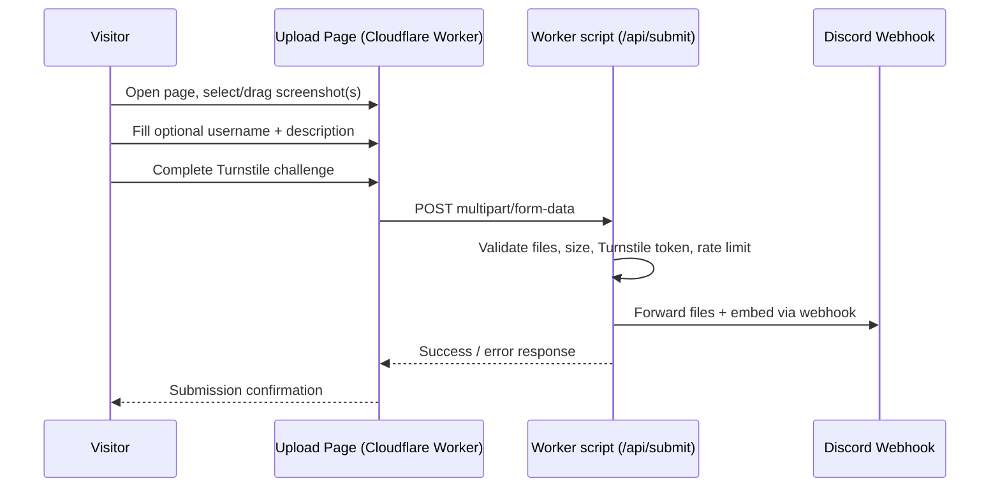

import BuyMeACoffeeButton from '@site/src/components/BuyMeACoffeeButton';

# **Screenshot Upload to Discord**

This project is a small, standalone website that lets anyone submit a screenshot — with an optional username/player ID and description — without needing a Discord account or signing in. Submissions are forwarded straight into a Discord channel through a **Discord webhook**.

It's built as a separate **Cloudflare Worker with static assets** (independent from this documentation site), with a small Worker script handling the backend. There is no server to run or maintain.

## **How It Works**

1. A visitor opens the upload page and drags in (or selects) one or more screenshots.
2. They optionally add a username/player ID and a short description.
3. A **Turnstile** widget confirms the visitor isn't a bot.
4. The form submits to the Worker's `/api/submit` route.
5. The Worker validates the request (file type, size, count, Turnstile token, and basic rate limiting), then re-posts the files and details to your **Discord webhook**.
6. The screenshot and any details appear in your Discord channel, and the visitor sees a confirmation message.

## **What the Finished Page Includes**

- 📸 Screenshot upload with drag-and-drop support (up to 5 files, 10 MB each).
- 👤 Optional username or player ID field.
- 📝 Optional description field.
- 🛡️ Cloudflare Turnstile bot protection, server-side file validation, and basic per-IP rate limiting.
- ✅ A clear submission confirmation (or error) message.

## **Source Code**

The full source for the upload page and its backend function lives in this repository at:

- [Cloudflare/screenshot-upload](https://github.com/TrueBankai416/BankaiTechDocs/tree/main/Cloudflare/screenshot-upload)

## **Guide**

1. [Discord Webhook Setup](./Discord%20Webhook%20Setup) — Create the webhook that receives submissions.
2. [Deploying to Cloudflare Workers](./Deploying%20to%20Cloudflare%20Workers) — Configure Turnstile, deploy the project, and set the required secrets.

<BuyMeACoffeeButton />
